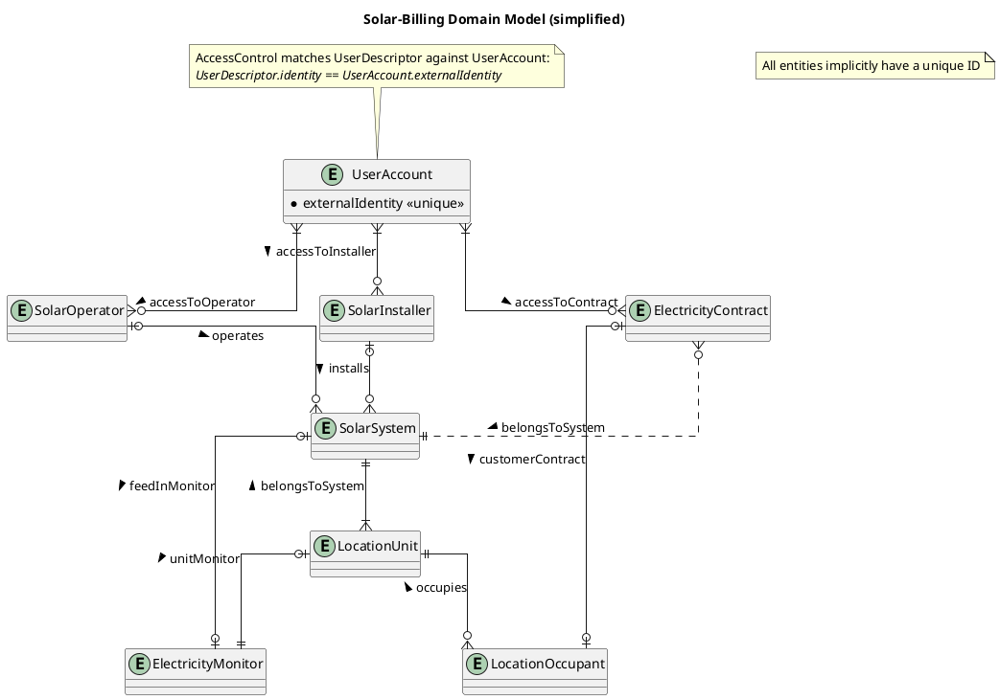

# Kiwi Access-Control Testing Module

&copy; 2025, werdenktwas GmbH  
Alexander Dahmen, Zoey Feld

## Introduction

The purpose of this `:demo:access-control-tests` module is to provide comprehensive and extensive test coverage of the
Kiwi-Framework `AccessControl` and `FieldAccessControl` mechanisms.
In conjunction, these two mechanisms are the base upon which access-control of entities is implemented within the Kiwi
EntitySchema system.

### AccessControl

AccessControl is a functional interface which, based on an application-specific _UserEntity_ type, allows for
row-based access control. An `AccessControl` instance can generate `Specification` instances for a given
`UserDescriptor`, filtering entities in database queries and only allowing the currently authenticated user to view
entities they are allowed to access.

Note that this Specification only filters for row-level access of the root entity, and not access to fields or related
entities. If access to specific fields, to-one or to-many relations needs to be checked, use the
fine-grained [FieldAccessControl](#fieldaccesscontrol) mechanism.

__Example__: Given a `UserAccount` entity with an `identity` attribute, corresponding to a `UserDescriptor.identity`
value, an AccessControl builder can be set up like this:

```kt
// 1. Create AccessControlBuilder, used to build AccessControl instances
val accessControl = AccessControlBuilder.byUserRelation<UserAccount> { account, user ->
    equal(account[UserAccount_.identity], user.identity)
}

// 2. Build AccessControl instances, specifying ReBAC (relation-based access control) rules for access
val firstExampleAccess = accessControl<Example> { example, account ->
    TODO("Implement first predicate for account-to-example access")
}
val secondExampleAccess = accessControl<Example> { example, account ->
    TODO("Implement second predicate for account-to-example access")
}

// 3. AccessControl rules can be combined using conjunction ("and"), disjunction ("or"), and negation ("not")
val readExample = firstExampleAccess or secondExampleAccess
```

### FieldAccessControl

FieldAccessControl is a functional interface which, based on an application-specific _UserEntity_ type, allows for
fine-grained access control of fields within an EntitySchema.
Unlike the previously discussed [AccessControl](#accesscontrol), this control is applied to EntitySchema data *after*
it is loaded from the database, i.e. when extracted from an entity object using an `EntityFieldset` or during
`JpaQuerySchemaService` processing, and is evaluated for each field of each loaded entity record individually.

__Example__: Given an `Company` entity with a security-sensitive `documents` to-many relation, a `FieldAccessControl`
instance can be attached to control access to this relation field:

```kt
// 1. Define an EntitySchema for the entity
object CompanySchema : EntitySchema<Company>() {
    val id by entityId()

    // ...
    val documents by toMany(Comany_.documents, DocumentSchema)

    // 2. Define a FieldAccessControl rule restricting access to company employees only
    private val accessEmployeeOnly = FieldAccessControl(
        require = { TODO("Define columns required for field evaluation") },
        checkAccess = { context -> TODO("Evaluate context against currently authenticated user, returning a Boolean") },
    )

    // 3. Attach previously defined FieldAccessControl to field
    override fun fieldAccessControl(toMany: QueryToMany<E, *, *, *>) = when (toMany) {
        documents -> accessEmployeeOnly
        else -> null // No FieldAccessControl for other toMany-fields
    }
}
```

## Testing Domain

The domain used for testing `AccessControl` and `FieldAccessControl` mechanisms is takes from the current (at time of
writing) domain model an internal residence solar-energy billing-system project.
This model was chosen as it offers sufficient complexity in a real-world scenario which requires all aspects of access
control offered by the Kiwi Framework.


