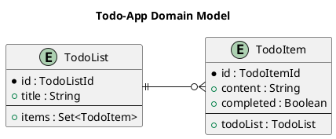

# 2. Domain Entities and Schema - Kiwi Server

This chapter introduces Entities, how to model and migrate them,
and how to represent their data using Query-Schema objects.

## Entities

Entity classes model the core domain of an application.
They define the data, state, operations, and relations to other entities within the system.  
Instances of an entity class can be persisted, managed, and queried using an EntityManager.

> According to
> the [JPA specification](https://jakarta.ee/specifications/persistence/3.1/jakarta-persistence-spec-3.1):  
> "An entity is a lightweight persistent domain object. The primary programming artifact is the entity class.
> An entity class may make use of auxiliary classes that serve as helper classes or that are used to represent the
> state of the entity."

In the Kiwi-Server Framework, entity classes should extend the abstract `BaseEntity<ID>` base class, and have a
dedicated ID class extending the abstract `EntityId` class.
Entity IDs are generated by the server as Snowflake IDs. See [Appendix: "Snowflake IDs"](./99-appendix.md#snowflake-ids)
for details on the Snowflake ID format, and how universally unique Entity IDs are generated.

Data and relations of an entity are stored in fields of the entity class, which are annotated with JPA annotations to
configure how entity instances are mapped from and to rows in the relational database.

This model of annotations is available at runtime as
the [JPA Metamodel](https://jakarta.ee/specifications/persistence/3.2/jakarta-persistence-spec-3.2#a6072),
which is generated at compile-time by
the [Hibernate Static Metamodel Generator](https://docs.jboss.org/hibernate/orm/7.0/introduction/html_single/Hibernate_Introduction.html#generator).

### Entity model

For the example todo-list application (see [Chapter 1: "Introduction"](./01-introduction.md) for setup), define a
simple domain model with two entities:



- The `TodoList` entity, identified by a `TodoListId`, has a `title` attribute, and a one-to-many relation
  to a set of `TodoItem` entities
- The `TodoItem` entity, identified by a `TodoItemId`, has a `content` and a `completed` attribute, and a many-to-one
  relation to one parent `TodoList` entity

<!--
Note: If you can't see the class diagram in your Markdown viewer, install
a [PlantUML plugin](https://plantuml.com/en-dark/running) if available,
or copy-paste the diagram code into the
[PlantUML online editor](https://editor.plantuml.com/uml/SoWkIImgAStDuL9NyCmhJYqgKGZ8ISmh2VNrKKZ9J4mlIinLo4WjIkLoICrB0Ie30000).
-->

### Entity classes

This model can be implemented in the example application like this:

```kotlin
// Entities are located in `domain` package
package com.example.domain

// Use Kiwi API classes
import de.kiwi.api.domain.*
// Use JPA annotations for persistence mapping
import jakarta.persistence.*

// (1) Define a dedicated ID type for TodoList
@Embeddable // Contains the `id` column attribute
class TodoListId(value: Long) : EntityId(value)

// (2) Define the TodoList entity
@Entity
@Table(name = "todo_list") // Map to database table
class TodoList(
    id: TodoListId,

    @Column(name = "title", length = 255, nullable = false)
    var title: String, // Map to database column: title VARCHAR(255) NOT NULL
) : BaseEntity<TodoListId>(id) { // Inherit from BaseEntity with dedicated TodoListId type
    // -> Inherits database column: id BIGINT NOT NULL PRIMARY KEY

    @OneToMany(mappedBy = "todoList") // Inverse side of bidirectional mapping
    val items: MutableSet<TodoItem> = HashSet()
}

// (3) Define dedicated ID type for TodoItem
@Embeddable
class TodoItemId(value: Long) : EntityId(value)

// (4) Define the TodoItem entity
@Entity
@Table(name = "todo_item") // Map to database table
class TodoItem(
    id: TodoItemId,

    @ManyToOne(optional = false)
    @JoinColumn(name = "todo_list_id", nullable = false)
    val todoList: TodoList, // Map to database column:
    // todo_list_id BIGINT NOT NULL REFERENCES todo_list (id)

    @Column(name = "content", columnDefinition = "TEXT", nullable = false)
    var content: String, // Map to database column: content TEXT NOT NULL

    @Column(name = "completed", nullable = false)
    var completed: Boolean, // Map to database column: completed BIT NOT NULL
) : BaseEntity<TodoItemId>(id) { // Inherits from BaseEntity with dedicated TodoItemId type
    // -> Inherits database column: id BIGINT NOT NULL PRIMARY KEY
}
```

When compiling the application module, the Hibernate JPA-Modelgen
(see [Chapter 1](./01-introduction.md#integrate-the-kiwi-server-framework) for integration) will generate a metamodel
for the defined entity classes. These generated metamodel classes will appear in the build directory
(`build/generated/source/kapt/main/`), declared in the same package as their corresponding entity classes.
This metamodel will later be used in ["Entity Schema and Fieldsets"](#entity-schema-and-fieldsets) to define how Kiwi
extracts data from the defined entities to build JSON data structures.

For the example `TodoItem` entity class above, the generated `TodoItem_` metamodel class will look like this:

```java
// Declared in same package as TodoItem entity
package com.example.domain;

// Static model "TodoItem_" for "TodoItem" entity, generated by annotation processor
@StaticMetamodel(TodoItem.class)
@Generated("org.hibernate.processor.HibernateProcessor")
public abstract class TodoItem_ extends de.kiwi.api.domain.BaseEntity_ {
    // Static attribute names, can be used for compile-safe lookup by property name
    public static final String COMPLETED = "completed";
    public static final String TODO_LIST = "todoList";
    public static final String CONTENT = "content";

    // Static metamodel attributes, can be used in EntitySchema and JPA Criteria queries
    // IMPORTANT NOTE: These attributes are initialized on startup by the JPA persistence unit
    // If you run code in an environment without an initialized JPA/Hibernate EntityManagerFactory,
    // these fields will be `null` and referencing them will lead to Exceptions!
    // See: Java Volatile keyword, https://www.baeldung.com/java-volatile
    public static volatile EntityType<TodoItem> class_;
    public static volatile SingularAttribute<TodoItem, Boolean> completed;
    public static volatile SingularAttribute<TodoItem, TodoList> todoList;
    public static volatile SingularAttribute<TodoItem, String> content;
}
```

## Database Migration

When trying to run the application immediately after declaring the entity classes,
Hibernate will throw an Exception on startup:

```
Caused by: org.hibernate.tool.schema.spi.SchemaManagementException: Schema-validation: missing table [todo_item]
```

This exception occurs when `spring.jpa.hibernate.ddl-auto` is set to `validate`, as it was
in [Chapter 1](./01-introduction.md#integrate-the-kiwi-server-framework).
This configuration validates that the database schema is compatible with the entities declared in the application
persistence unit.

### Liquibase ChangeSet

Kiwi-Server uses [Liquibase migrations](https://docs.liquibase.com/) to migrate an evolving database schema. Liquibase
is integrated into the Spring Framework, which allows the application to manage upgrades of the database schema version.

To add a new database migration, create a liquibase changelog file in `src/main/resources/db/migration/`.  
For this example, name the file `db.example-01.yaml`. This will contain the first version of the example-application
database schema.

```yaml
## Changelog of first application database schema version
databaseChangeLog:
  ## (1) First changeset in changelog
  - changeSet:
      # Changeset is identified by ID and Author
      id: initial-example
      author: your-name-here
      changes:
        ## (2) Create the "todo_list" table
        # The table name and columns *must* match the mapping specified
        # by the JPA @Table/@Column/... annotations in the entity class
        - createTable:
            tableName: todo_list
            columns:
              - column:
                  name: id
                  type: bigint
                  constraints: { primaryKey: true, nullable: false }
              - column:
                  name: title
                  type: varchar(255)
                  constraints: { nullable: false }
        ## (3) Create the todo_item table
        - createTable:
            tableName: todo_item
            columns:
              - column:
                  name: id
                  type: bigint
                  constraints: { primaryKey: true, nullable: false }
              - column:
                  # This column is mapped to the @ManyToOne todoList relation
                  name: todo_list_id
                  type: bigint
                  constraints:
                    nullable: false
                    foreignKeyName: fk_todo_item_list
                    referencedTableName: todo_list
                    referencedColumnNames: id
                    deleteCascade: true
              - column:
                  name: content
                  type: text
                  constraints: { nullable: false }
              - column:
                  name: completed
                  type: bit
                  constraints: { nullable: false }
```

Finally, append the changelog master file in `src/main/resources/db/migration/db.changelog-master.yaml`
to include the new migration file:

```yaml
# Master changelog in db.changelog-master.yaml file
databaseChangeLog:
  ## Other database migrations included previously
  - include: [ ... ]
  ## (1) Include the new changelog file in the master changelog
  - include:
      file: db.example-01.yaml
      relativeToChangelogFile: true # Located in same directory as master changelog file
```

### Database ChangeLog

When the application is started now, the pending database migration will be executed on startup.  
Check the output logs as the application starts:

```
Reading from mydatabase.DATABASECHANGELOG
Running Changeset: db/changelog/db.example-01.yaml::initial-example::your-name-here
Table todo_list created
Table todo_item created
ChangeSet db/changelog/db.example-01.yaml::initial-example::your-name-here ran successfully in [...]ms

UPDATE SUMMARY
Run:                          1
Previously run:               2
Filtered out:                 0
-------------------------------
Total change sets:            3

Update summary generated
Update command completed successfully.
Liquibase: Update has been successful. Rows affected: 1
```

The tables mapped to entity classes have successfully been created.
The executed migrations have been appended to the `DATABASECHANGELOG` table.

Hibernate will now successfully validate the database schema:

```
Initialized JPA EntityManagerFactory for persistence unit 'default'
[...]
Tomcat started on port 8080 (http) with context path '/'
Started ExampleApplicationKt in [...] seconds (process running for [...])
```

If you have a connection to the test database, you can verify that all tables exist using the database console:

```
mysql> show tables;
+-----------------------+
| Tables_in_mydatabase  |
+-----------------------+
| DATABASECHANGELOG     |
| DATABASECHANGELOGLOCK |
| todo_item             |
| todo_list             |
| kiwi_audit_log        |
| kiwi_file             |
+-----------------------+
6 rows in set (0.00 sec)
```

- The Kiwi Audit-Log module created the `kiwi_audit_log` table
- The Kiwi Storage module created the `kiwi_file` table
- The new migration file `db.example-01.yaml` created the `todo_item` and `todo_list` tables
- Liquibase itself created and uses the `DATABASECHANGELOG` and `DATABASECHANGELOGLOCK` tables
    - Executed migrations are stored in `DATABASECHANGELOG`, only new migrations are executed on startup
    - The table `DATABASECHANGELOGLOCK` is used to ensure multiple migrations don't happen at the same time

The database is now ready to store and query entity data.

> Note: When entities change, new entities are added, or entities are deleted, the database schema *must* be changed
> accordingly. Hibernate helps in this process by validating that the database schema is compatible with the declared
> entities.  
> Either extend an existing changeSet to include new changes or create a new changeSet to migrate the database to a new
> version of the schema.  
> You can use IDE tools like [JPA Buddy](https://jpa-buddy.com/) to generate part of the database changelogs
> automatically using a [Liquibase Diff](https://docs.liquibase.com/commands/inspection/diff.html).

## Entity Schema and Fieldsets

An Entity Schema in Kiwi-Server is definition how to represent entity data using hierarchical JSON data-structures.

EntitySchema instances are global singleton objects
(see [Kotlin: "Object declarations"](https://kotlinlang.org/docs/object-declarations.html)) that define column fields,
to-one relation fields, to-many relation fields, and to-many-map relation fields.
Fields are defined by declaring delegated properties on the respective EntitySchema object.

- Value fields are represented by `ColumnField` objects
- To-one relation fields are represented by `ToOneField` objects
- To-many collection relation fields are represented by `ToManyField` objects
- To-many map (key-value collection) relation fields are represented by `ToManyMapField` objects

As an advanced feature, EntitySchema can define fine-grained control controlling which fields are allowed to be
accessed, see [Chapter 4: "Field Access Control"](./04-querying-access-control.md#field-access-control).

For an overview class diagram of EntitySchema classes,
see [Appendix: "EntitySchema class diagram"](./99-appendix.md#entityschema-class-diagram).

### ColumnField

The ColumnField class represents JSON value fields defined for an EntitySchema.
ColumnField fields can be declared using the `by column(...)` delegate, which accepts parameters to specify a selector,
a column type, and column flags.
The delegates `by primaryKey(...)`, `by entityId(...)`, `by parentEntityId(...)`, `by entityType(...)`, and
`by entityDiscriminator(...)` offer convenience methods to declare commonly used columns with special selectors and
attributes.

An instance of ColumnField has the following properties:

- Its associated `fieldName` string
- A boolean flag indicating if this column is a `primaryKey`, uniquely identifying its associated entity
- A boolean flag indicating if this column is `nullable`
- A `ColumnSelector` object associating the `ColumnField` object with an attribute value of the underlying entity
- A `ColumnType` object formatting the entity attribute value into a serializable representation, and providing a
  `ColumnFilterSet` of filter operators available for filtering when querying entities

#### ColumnType

The ColumnType interfaces determines how an entity attribute value is represented in a data structure, how data values
can be parsed back into attribute values, and which operators can be applied to the column when querying
entities (see ["ColumnFilterSet"](#columnfilterset)).

Attribute values of entities are passed to the ColumnType of their associated ColumnField to be formatted, resulting in
a formatted value. This formatted value can then be passed to the [Jackson library](https://www.baeldung.com/jackson) to
serialize the values as JSON data structures.

For common types, Kiwi pre-defines a set of common ColumnTypes:

- `IdentityColumnType`, which can be instantiated using `ColumnType.identity<T>()`, simply passes the attribute value
  as-is without applying any transformation
    - This type is commonly used for simple value types, such as strings, numbers or booleans, which can be directly
      mapped to JSON values
    - This is the default ColumnType used for ColumnFields declared `by colum(...)`, unless another ColumnType is
      explicitly specified
- `EntityIdColumnType`, which can be instantiated using `ColumnType.entityId<ID : EntityId>()`, handles formatting and
  parsing of specific EntityId subclasses
    - Entity IDs are represented as strings using base32 encoding,
      see [Appendix: "Snowflake IDs"](./99-appendix.md#snowflake-ids)
- `EnumColumnType`, which can be instantiated using `ColumnType.enum<E : Enum<E>>()`, handles formatting and parsing
  specific enum classes using enum member names
    - Enums are represented as strings, based on their enum member name
- `EntityClassNameType` and `EntityDiscriminatorValueType`, respectively, extract the simple Java class name and the
  entity `@DiscriminatorValue` annotation value from the given entity class value
- `IsoLocalDateType`, `IsoLocalTimeType`, and `IsoLocalDateTimeType` respectively map `LocalDate`, `LocalTime` and
  `LocalDateTime` values to [ISO-8601](https://en.wikipedia.org/wiki/ISO_8601) formatted strings
- `DataSizeType`, `UriType`, `UuidType` `BigDecimalType`, and `BigIntegerType` are basic column types for the respective
  types `DataSize`, `URI`, `UUID`, `BigDecimal` and `BigInteger`
- `BasicColumnType` is an abstract class, which serves as a base class for custom column types specific to individual
  applications

Creating custom column types, or deriving new column types from existing instances, is covered under the advanced topics
in [Chapter 8: "Custom ColumnTypes"](./08-advanced.md#custom-columntypes).

#### ColumnSelector

The ColumnSelector interface is responsible for reading, writing, and selecting attribute values of entities.

Kiwi provides three standard selector implementations:

- `AttributeSelector`, which can be instantiated using the `attribute(...)` selector function, selects the value of an
  entity attribute using a recursive attribute path composed of `SingularAttribute` attributes
- `ComputedSelector`, which can be instantiated using the `computed(...)` selector function, dynamically computes an
  attribute value from an entity using a given function and equivalent Criteria SQL expression
- `EntityTypeSelector`, used by the `by entityType()` and `by entityDiscriminator()` delegate functions, selects the
  runtime Java class of the entity

### ToOneField

The ToOneField class represents JSON fields referencing one object of another EntitySchema.
ToOneField fields can be declared using the `by toOne(...)` delegate, which accepts parameters to specify a relation
`SingularAttribute`, the referenced schema, and a nullability flag.

An instance of ToOneField has the following properties:

- Its associated `fieldName` string
- A boolean flag indicating if this relation is `nullable`
- A reference to the foreign schema of the `toOne` relation
- The `attribute` referencing the foreign entity of the relation

### ToManyField

ToManyField/ToManyMapField represents a JSON field referencing a collection of objects of another EntitySchema.
ToManyField represents a reference to a list of values, and ToManyMapField represents a reference to a collection of
key-value pairs.
ToManyField/ToManyMapField fields can be declared using the `by toMany(...)` delegate, which accepts parameters to
specify a relation collection or map attribute, and the referenced schema/key- and value-schemata.

An instance of ToManyField has the following properties:

- Its associated `fieldName` string
- A reference to the foreign schema of the `toMany` relation
- The `attribute` referencing the list, set, or collection of foreign entities of the relation

An instance of ToManyMapField has the following properties:

- Its associated `fieldName` string
- A reference to the foreign key- and value-schema of the keys and values of the `toManyKeys`/`toManyValues` relation
- The `attribute` referencing the map of foreign entity keys/values of the relation

### Define an EntitySchema

To define an entity schema for an entity of class `E`, declare a singleton `object` inheriting from `EntitySchema<E>`.
Within this object, properties declared `by column(...)`, `by toOne(...)` or `by toMany(...)` will be registered as
schema fields.

EntitySchema objects define how entities can be queried and processed into a JSON data-structure representation
that can be serialized, deserialized, and used for to represent the entity outside the application.

The EntitySchema objects for the example todo-app entities defined above can be implemented like this:

```kotlin
// Located in `domain` package
package com.example.domain

// Use Kiwi API classes
import de.kiwi.api.schema.*
// References domain classes
import com.example.domain.*

// (1) Define an EntitySchema for TodoList entity
object TodoListSchema : EntitySchema<TodoList>() {
    // Field "id" is a ColumnField<TodoList, TodoListId, String>
    // Associated with property BaseEntity::id
    val id by entityId()

    // Field "title" is a ColumnField<TodoList, String, String>
    // Associated with property TodoList::title
    val title by column(TodoList::title)

    // Field "items" is a ToManyField<TodoList, Set<TodoItem>, TodoItem, TodoItem>
    // Associated with property TodoList::items, references TodoItemSchema
    val items by toMany(TodoList::items, TodoItemSchema)
}

// (2) Define an EntitySchema for TodoItem entity
object TodoItemSchema : EntitySchema<TodoItem>() {
    // Field "id" is a ColumnField<TodoItem, TodoItemId, String>
    // Associated with property BaseEntity::id
    val id by entityId()

    // Field "todoList" is a ToOneField<TodoItem, TodoList>
    // Associated with property TodoItem::todoList, references TodoListSchema
    val todoList by toOne(TodoItem::todoList, TodoListSchema)

    // Field "content" is a ColumnField<TodoItem, String, String>
    // Associated with property TodoItem::content
    val content by column(TodoItem::content)

    // Field "completed" is a ColumnField<TodoItem, String, String>
    // Associated with property TodoItem::completed
    val completed by column(TodoItem::completed)
}
```

This EntitySchema defines a JSON data structure for representing entities.
A corresponding type definition in TypeScript would look like this:

```typescript
// Alias types used for Entity IDs, with nominal marking of ID subtype
type TodoListId = string & { idType: "TodoList" }
type TodoItemId = string & { idType: "TodoItem" }

// JSON objects matching TodoListSchema
interface ITodoList {
  id?: TodoListId
  title?: string
  items?: Array<ITodoItem>
}

// JSON objects matching TodoItemSchema
interface ITodoItem {
  id?: TodoItemId
  todoList?: ITodoList
  content?: string
  completed?: boolean
}
```

As a feature, Kiwi-Server can generate these Typescript source files for you.
See [Chapter 7: "Frontend Code-Generation"](./07-testing.md#frontend-code-generation) for more information on
source-code generations for EntitySchema declarations.

### Fieldsets

A fieldset is a named object, referencing an entity schema that determines which fields of the
referenced schema should be included in the JSON data structure. An entity schema should have a corresponding singleton
object defining its available fieldsets, with each entity schema having a "default" fieldset.
Fieldset objects are defined by delegated properties declared on the respective FieldsetsAvailable object,
executing a fieldset-definition builder function upon initialization.

See [Chapter 4: "QuerySchemaService"](./04-querying-access-control.md#queryschemaservice) on using fieldsets when
querying entity data from the database using the QuerySchemaService.

### Define available fieldsets

To define the fieldsets available for an entity schema, declare a singleton `object` inheriting from
`FieldsetsAvailable` and pass the EntitySchema singleton as the supertype constructor parameter.
Within this object, properties declared `by defineFieldset { ... }` will be registered as named fieldsets.

The builder function passed to `defineFieldset` determines which column fields, to-one relation fields, and
to-many/to-many-map fields will be included in the fieldset. Every fieldset is initialized empty, and fields can be
included or later excluded within the builder function.

Methods to modify which fields are included or excluded are:

- `extendsFieldset(Fieldset<E>)` includes all fields included in the other fieldset passed as the parameter
- `includeAllColumns()` includes all ColumnField fields declared in the EntitySchema; note that this does not include
  ToOneField, ToManyField, or ToManyMapField relation fields
- `includePrimaryKeys()` includes all ColumnField fields declared in the EntitySchema that are marked with the
  `primaryKey` flag
- `include(vararg ColumnField<E>)` includes the given ColumnField fields passed as parameters
- `includeToOne(ToOneField<E, R>, fieldset: Fieldset<R>)` includes the given to-one relation, using the referenced
  foreign fieldset to extract values from the referenced foreign entity
- `includeToMany(ToManyField<E, R>, fieldset: Fieldset<R>)` includes the given to-many collection relation, using the
  referenced fieldset to extract values from the referenced foreign entity collection items
- `includeToMany(ToManyMapField<E, K, V>, Pair<Fieldset<K>, Fieldset<V>>)` includes the given to-many-map collection
  relation, using the referenced key- and value-fieldsets to extract keys and values from the referenced foreign
  entity key-value map entries
- `excludeAllToOne()` excludes all to-one relation fields previously included
- `excludeAllToMany()` excludes all to-many and to-many-map relation fields previously included
- `exclude(vararg EntitySchemaField<E>)` excludes the given fields (ColumnFields, ToOneFields, ToManyFields, or ToManyMapFields) if previously included

The FieldsetsAvailable objects for the example todo-app entity schemata defined above can be implemented like this:

```kotlin
// Continue in same file as EntitySchema declarations
package com.example.domain

// See above, "Define an EntitySchema"
object TodoListSchema : EntitySchema<TodoList> { /* [...] */ }
object TodoItemSchema : EntitySchema<TodoItem> { /* [...] */ }

// (1) Define named fieldsets available for TodoList, based on TodoListSchema
object TodoListFieldsets : FieldsetsAvailable<TodoList>(TodoListSchema) {
    // (2) Default fieldset is required, must override abstract property
    override val default by defineFieldset {
        // Includes TodoListSchema.id, TodoListSchema.title
        includeAllColumns()
    }

    // (3) Details fieldset, representing entity with child entities
    val details by defineFieldset {
        // Includes TodoListSchema.id, TodoListSchema.title from default fieldset
        extendsFieldset(default)
        // Includes TodoListSchema.items to-many relation,
        // using TodoItem-fieldset "default" to represent items in collection
        includeToMany(TodoListSchema.items, TodoItemFieldsets.default)
    }

    // More fieldsets can be defined here ...
}

// (4) Defined named fieldsets available for TodoItem, based on TodoItemSchema
object TodoItemFieldsets : FieldsetsAvailable<TodoItem>(TodoItemSchema) {
    // (5) Default fieldset is required, must override abstract property
    override val default by defineFieldset {
        // Includes TodoItemSchema.id, TodoItemSchema.content, TodoItemSchema.completed
        includeAllColumns()
    }

    // (6) Details fieldset, representing entity with parent entity
    val details by defineFieldset {
        // Includes fields from default fieldset
        extendsFieldset(default)
        // Includes TodoItemSchema.todoList to-one relation,
        // using TodoList-fieldset "default" to represent the referenced entity
        includeToOne(TodoItemSchema.todoList, TodoListFieldsets.default)
    }

    // More fieldsets can be defined here ...
}
```

> Important note: It is possible to define an infinite recursion using fieldsets with a bidirectional relation.  
> If you do this, using the fieldset will crash with a *StackOverflowError* one way or another. Please be cautious!

These fieldsets define JSON data structures for representing entities with specific fields.
A corresponding type definition in Typescript would look like this:

```typescript
// Alias types used for Entity IDs, with nominal marking of ID subtype
type TodoListId = string & { idType: "TodoList" }
type TodoItemId = string & { idType: "TodoItem" }

// JSON object matching TodoListFieldsets.default
interface ITodoListDefault {
  id: TodoListId
  title: string
}

// JSON object matching TodoListFieldsets.details
interface ITodoListDetails extends ITodoListDefault {
  items: Array<ITodoItemDefault>
}

// JSON object matching TodoItemFieldsets.default
interface ITodoItemDefault {
  id: TodoItemId
  content: string
  completed: boolean
}

// JSON object matching TodoItemFieldsets.details
interface ITodoItemDetails extends ITodoItemDefault {
  todoList: ITodoListDefault
}
```

As a feature, Kiwi-Server can generate these Typescript source files for you.
See [Chapter 7: "Frontend Code-Generation"](./07-testing.md#frontend-code-generation) for more information on
source-code generations for entity schema.

### Extracting entity data using Fieldsets

Fieldset objects can be used to extract data structures from entities.

Data structures are assembled using a FieldsetSerializer implementation.
Kiwi provides two implementations out of the box:

- BasicFieldsetSerializer, representing entity data using Java collections:
    * `LinkedHashMap` for objects
    * `ArrayList` for lists
    * Simple POJOs for column values
- JsonFieldsetSerializer, representing entity data using Jackson JSON nodes
    * `ObjectNode` for objects
    * `ArrayNode` for lists
    * `JsonNode` wrapping column values

To extract data from an entity instance, use the extract methods on a specific fieldset:

- `fun Fieldset<E>.extract(E): Any?` extracts entity data and assembles data structures using the
  _BasicFieldsetSerializer_, returning plain Java collections and objects
- `fun Fieldset<E>.extractJson(E): JsonNode` extracts entity data and assembles data structures using the
  _JsonFieldsetSerializer_, returning a JsonNode representation of the entity
- `fun <N> Fieldset<E>.extract(E, FieldsetSerializer<N>): N` extracts entity data and assembles data structures using
  the given FieldsetSerializer, returning a serialized representation determined by the serializer type

### Dynamic fieldsets

While most cases use named fieldsets, statically declared in FieldsetsAvailable objects, it is possible to dynamically
define a fieldset on the fly. The name of these dynamic fieldsets will contain a UUID, marking them as ephemeral and
representing their anonymous identity.

A dynamic fieldset can be defined anywhere like this:

```kotlin
// Build dynamic fieldset for TodoItem entities,
// including the fields TodoItemSchema.id and TodoItemSchema.content
val exampleDynamicFieldset = TodoItemSchema.buildFieldset {
    include(TodoItemSchema.id, TodoItemSchema.content)
}

// Example usage: Load TodoItem, extract objects using dynamic fieldset
val exampleItem: TodoItem = TODO("Load TodoItem from database ...")
val exampleItemData = exampleDynamicFieldset.extractJson(exampleItem)
println(exampleItemData) // => { "id": "...", "content": "..." }
```

See [Chapter 6: "Dynamic Fieldsets"](./06-web-mvc-endpoints.md#dynamic-fieldsets) for more on using dynamic
fieldsets when querying entity data from the REST API using the `_fields` query parameter.

## Entity Validation

Kiwi supports validation of entity fields using the `Validation<T>` interface.
An instance of a Validation accepts an input value, and either returns a successful validation with an output value, or
rejects the input value with a reason why the validation failed, represented as a `Validation.Result<T>`.

Validation instances can also be used like functions using the `invoke` operator with an input value, returning the
validated value upon validation success or throwing a `ValidationFailed` Exception on failure.

Additionally, an instance of a validation can be associated with a specific field name, binding the validation to the
field of a specific entity type. This later can be used to automatically apply validations to ColumnFields,
see ["Auto Column Validation"](#auto-column-validation).

Kiwi provides helper functions in the Validation interface companion object to define validations:

- `fun <T> assert(reason: String, (T) -> Boolean): Validation<T>` defines a validation that passes input
  values to the given predicate function. If the function returns true, a success result is returned. Otherwise, a
  failure result with the given reason is returned
- `fun <T> map((T) -> T): Validation<T>` defines a validation that passes input values to the given mapper
  function, and always returns a success result with the mapped result value
- `infix fun <T> Validation<T>.and(Validation<T>): Validation<T>` defines a validation that combines two validations,
  applying them one after another
- `val <T> Validation<T>.orNull: Validation<T?>` defines a validation that accepts null input values, or otherwise
  passes on the non-null input value
- `val <T> Validation<T>.notNull: Validation<T?>` defines a validation that rejects null input values, or otherwise
  passes on the non-null input value
- `fun <T> KProperty<T>.validateColumn(): Validation<T>` defines a validation associated with the column represented by
  a Kotlin property

Kiwi also provides a set of standard validators in the Validation companion object:

- `Validation.notEmpty` validates that the given input string value is not empty
- `Validation.notBlank` validates that the given input string value is not blank, i.e. only contains whitespace
- `Validation.validEmail` validates that the given input string value is a valid e-mail address
- `Validation.toUppercase` is a validation mapping the given input string value to uppercase
- `Validation.toLowercase` is a validation mapping the given input string value to lowercase
- `Validation.maxLength(Int)` validates that the given input string value is not longer than the given max length
- `Validation.matchesRegex(reason: String, Regex)` validates that the given input string value matches the given regular
  expression
- `Validation.nullIf((T) -> Boolean)` is a validation mapping the given input value to null if the predicate function
  returns true
- `Validation.nullIfEmpty` is a validation mapping the given input string value to null if the string is empty
- `Validation.nullIfBlank` is a validation mapping the given input string value to null if the string is blank, i.e.
  only contains whitespace

### Declaring validations

By convention, validations for a specific entity class are declared within the class `companion object`.
Validations can be composed of multiple validations to validate all aspects of a value.

The example todo-application, entities can be extended like this to include validations:

```kotlin
// Located in `domain` package
package com.example.domain

// Use Kiwi API classes
import de.kiwi.api.domain.*
// Use Kiwi Validation
import de.kiwi.api.domain.Validation.Validators.and
import de.kiwi.api.domain.Validation.Validators.notBlank
import de.kiwi.api.domain.Validation.Validators.notEmpty
import de.kiwi.api.domain.validateColumn
// Use JPA annotations for persistence mapping
import jakarta.persistence.*

// [...]

@Entity
@Table(name = "todo_list")
class TodoList(
    id: TodoListId,

    @Column(name = "title", length = 255, nullable = false)
    var title: String,
) : BaseEntity<TodoListId>(id) {

    @OneToMany(mappedBy = "todoList")
    val items: MutableSet<TodoItem> = HashSet()

    // NEW: Companion object of TodoList entity class
    companion object {
        // (1) Define validations for TodoList entity fields
        // Validate title property:
        //  1. Associated with "title" field, not nullable, max length = 255
        //  2. Must not be blank, i.e. empty or only containing whitespace
        val validTitle = TodoList::title.validateColumn() and notBlank

        // (2) Static factory for creating TodoList entity instances
        fun create(title: String) = TodoList(
            // Generate unique TodoListId for new entity instance
            id = EntityId.generate<TodoListId>(),
            // Validate given title value before passing title to constructor
            // -> Will throw a ValidationFailed Exception if given title is invalid
            title = validTitle(title),
        )
    }
}

@Entity
@Table(name = "todo_item")
class TodoItem(
    id: TodoItemId,

    @ManyToOne(optional = false)
    @JoinColumn(name = "todo_list_id", nullable = false)
    val todoList: TodoList,

    @Column(name = "content", columnDefinition = "TEXT", nullable = false)
    var content: String,

    @Column(name = "completed", nullable = false)
    var completed: Boolean,
) : BaseEntity<TodoItemId>(id) {

    // NEW Companion object of TodoItem entity class
    companion object {
        // (1) Define validations for TodoItem entity fields
        // Validate content property:
        //  1. Associated with "content" field, not nullable, max length = length of TEXT
        //  2. Must not be empty, i.e. zero-length string
        val validContent = TodoItem::content.validateColumn() and notEmpty

        // Validate completed property:
        //  1. Associated with "completed" field, not nullable
        val validCompleted = TodoItem::completed.validateColumn()

        fun create(todoList: TodoList, content: String) = TodoItem(
            // Generate unique TodoItemId for new entity instance
            id = EntityId.generate<TodoItemId>(),
            todoList = todoList,
            // Validate given content and completed status before passing values to constructor
            // -> Will throw a ValidationFailed Exception if given value is invalid
            content = validContent(content),
            completed = validCompleted(false),
        )
    }
}
```

> Note: The `fun create(...)` pattern within an entity `companion object`, as seen above, will be used throughout the
> rest of this guide, and is part of the conventions for applications built using Kiwi-Server.

### Auto Column Validation

When a validation is declared as a property on an entity companion object using `KProperty<*>.validateColumn()`, it
automatically becomes eligible for automatic validation lookup.
The helper object `ColumnAutoValidation` is able to look up the validation instance associated with a
`SingularAttribute` from the metamodel of an entity class.

This automatic validation lookup is used when reading attribute values from columns during command processing.
See [Chapter 3: "Generic Create and Update"](./03-application-command-query.md#generic-create-update-and-delete) for how
auto
column validation is used with create- and update-commands.

---

After this chapter, your example todo-application has defined entities, their database mapping and migration,
entity data validation, and a schema for data-structures representing entity data.

Next up, [Chapter 3: "Application Commands, Queries and Events"](./03-application-command-query.md) is about defining
the commands, queries, and events of the application, to add interactions, business logic, and use-cases to your
application.
