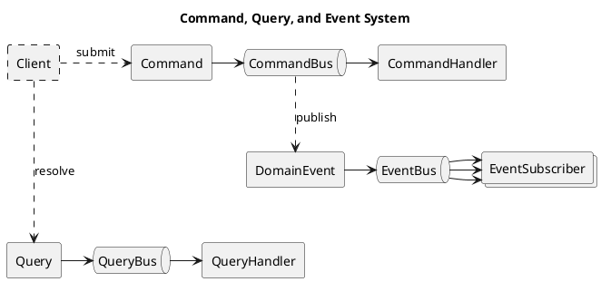
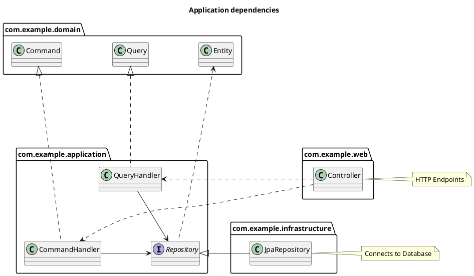

# 3. Application Commands, Queries and Events - Kiwi Server

This chapter introduces commands, queries and events, and how to implement application logic and use-cases.

## Commands, Queries and Events

Interaction with the application core is defined using commands, queries and events.

Kiwi-Server follows
the [Command-Query Responsibility Segregation](https://en.wikipedia.org/wiki/Command_Query_Responsibility_Segregation)
principle: Read-only queries accessing the state of the system are strictly separated from read-write commands changing
the state of the system.

- Queries are resolved by the **QueryBus**.  
  The QueryBus handles cross-cutting concerns, and forwards queries to their associated QueryHandler.
  The result of the handler is returned from the QueryBus.

- Commands are submitted to the **CommandBus**.  
  The CommandBus handles cross-cutting concerns, and forwards commands to their associated CommandHandler.
  This CommandHandler returns a collection of DomainEvents alongside a result value as a DomainResult.
  Emitted events are published onto the EventBus after handling the command, but before the result is returned
  from the CommandBus. The DomainResult of the handler is returned from the CommandBus.

- DomainEvents are emitted when handling Commands and published onto the **EventBus** by the CommandBus.  
  The EventBus logs the events using an AuditLoggerService, and forwards events to matching EventSubscribers.
  EventSubscribers may emit follow-up events, which are published recursively until all events are processed.

This diagram shows an overview of the command-, query-, and event-system:



For the example todo-application, first define the following commands, queries, and events:

```kt
// Commands, queries and events belong to the application domain core
package com.example.domain

// import [...], omitted for brevity

// (1) Declare the command to create a new TodoList entity
data class CreateTodoList(val title: String) : Command()

// (2) Declare the command to create a new TodoItem entity, which belongs to a specific TodoList
data class CreateTodoItem(val listId: TodoListId, val content: String) : Command()

// (3) Declare the command to mark a TodoItem entity as completed
data class MarkTodoItemCompleted(val itemId: TodoItemId, val completed: Boolean) : Command()

// (4) Declare the event emitted when a new TodoList entity has been created
data class TodoListCreated(val entity: TodoList) : DomainEvent() {
    // Use default TodoList-fieldset to serialize details data for audit-log
    override val details = TodoListFieldsets.default.extract(entity)
}

// (5) Declare the event emitted when a new TodoItem entity has been created
data class TodoItemCreated(val entity: TodoItem) : DomainEvent() {
    // Use default TodoItem-fieldset to serialize details data for audit-log
    override val details = TodoItemFieldsets.default.extract(entity)
}

// (6) Declare the event emitted when a TodoItem entity has been modified
data class TodoItemModified(val entity: TodoItem) : DomainEvent() {
    // Use default TodoItem-fieldset to serialize details data for audit-log
    override val details = TodoItemFieldsets.default.extract(entity)
}

// (7) Declare the query for retrieving JSON data representing all TodoList entities
class GetTodoLists : Query<List<JsonNode>>()

// (8) Declare the query for retrieving JSON data representing all TodoItems that belong to a specific TodoList
class GetTodoItems(val listId: TodoListId) : Query<List<JsonNode>>()
```

These declarations define how the system can be interacted with,
providing methods for accessing data using queries or changing state using commands.

> Note: The commands and queries declared above offer _no inherent authorization or access-control_ by themselves.
> These features will be discussed in [Chapter 4: "Access Control"](./04-querying-access-control.md#access-control).

The following sections will explain how these commands and queries can be handled, and implement the application logic
of the example todo-application.

## Repository- and Service-Interfaces

The application layer of a project should define the core functionality and use-cases of the application,
and depends on the classes defined in the application domain.

For access to external resources, like querying and persisting entities in a database or communicating with external
system like e-mails or external APIs, repository- and service interfaces should be defined in the application layer.
This design follows the ["Dependency Inversion Principle"](https://en.wikipedia.org/wiki/Dependency_inversion_principle)
to ensure all dependencies in the application point inwards, from the outer infrastructure to the inner application core
and domain.

The domain, application and infrastructure layers should adhere to the following pattern:

- The domain layer does not depend on anything but itself, defining the core domain entities, structure, and entity
  logic
- The application layer defines command-/query-handlers, event-subscribers, and repository-/service-interfaces that
  depend on and define logic for the core domain
- The infrastructure layer depends on the core domain and provides implementations for interfaces required by the
  domain layer
- The web layer depends on the core domain and submits commands/queries to the application layer to respond to web
  requests



<!--
Note: If you can't see the class diagram in your Markdown viewer, install
a [PlantUML plugin](https://plantuml.com/en-dark/running) if available,
or copy-paste the diagram code into the
[PlantUML online editor](https://editor.plantuml.com/uml/SoWkIImgAStDuL9NyCmhJYqgKGZ8ISmh2VNrKKZ9J4mlIinLo4WjIkLoICrB0Ie30000).
-->

For the example todo-application,
declare [Spring-Data Repository Interfaces](https://docs.spring.io/spring-data/jpa/reference/repositories/definition.html)
for the entities previously defined in [Chapter 2: "Entities"](./02-domain-schema.md#entities).
These interfaces will be automatically scanned and instantiated as beans by Spring-Data without requiring an explicit
implementation if `@EnableJpaRepositories` annotates an application configuration class.

```kotlin
// Service interfaces belong to the application layer
package com.example.application

// Reference previously defined domain entity classes
import com.example.domain.*
// Use Spring-Data JPA for repository interfaces
import org.springframework.data.jpa.repository.JpaRepository
import org.springframework.stereotype.Repository

// (1) Declare a standard repository for TodoList entities
@Repository
interface TodoListRepository : JpaRepository<TodoList, TodoListId>

// (2) Declare a standard repository for TodoItem entities
@Repository
interface TodoItemRepository : JpaRepository<TodoItem, TodoItemId>
```

If your application logic requires specific entity queries, you can
declare [Spring-Data Query Methods](https://docs.spring.io/spring-data/jpa/reference/repositories/query-methods-details.html)
to define queries for the given repository.

If your application logic requires flexible, programmatic queries, you can extend the repository interface from
[JpaSpecificationExecutor](https://docs.spring.io/spring-data/jpa/reference/jpa/specifications.html) to use
Specifications for executing programmatically generated queries.

## User-Descriptor Interface

The UserDescriptor is an interface representing a user authentication in the system, implemented by the underlying
authentication mechanism. Instances don't have to be bound to a specific user entity or authentication method, but
rather the _concept_ of someone or something being authenticated within the system.

An instance of a UserDescriptor provides the following attributes about the user authentication:

- A **username** String, which should be a unique handle tied to the user's identity
- An **identity** value, strictly uniquely identifying the user by its value equality (`equalTo` method)
- An optional **userId** number, which may be a unique numeric identifier if the underlying user identity supports this
- An **authenticated** Boolean flag, indicating if the user is successfully authenticated or unauthenticated/anonymous
- A set of **roles** assigned to the user, most importantly among them potentially the very important `"ADMIN"` role
- The underlying **principal** of the authentication, which is an object specific to the actual UserDescriptor
  implementation

For every command- or query-execution, a UserDescriptor instance _must_ be given
associating the execution with a user responsible for it.
The UserDescriptor should be used to determine authorization of queries and commands.
Fine-grained authorization functionality is discussed
in [Chapter 4: "Access Control"](./04-querying-access-control.md#access-control).

The `UserDescriptorProvider` interface, provided as a bean by Kiwi-Server Framework, provides access to a UserDescriptor
instance representing the currently authenticated user.
How exactly the currently authenticated user is determined depends on the specific UserDescriptorProvider
implementation, which is discussed
in [Chapter 5: "Spring Security integration"](./05-infrastructure-integration.md#spring-security-integration).

There are two global instances of the UserDescriptor interface, intended for special use:

- The `UserDescriptor.SYSTEM` is a system-internal user descriptor, **bypassing normal authorization** and acting like a
  system-wide root superuser. Most security checks are *disabled* when using this specific descriptor.
  > **WARNING**: Be *very* careful when using this UserDescriptor, as it may potentially lead to security
  > vulnerabilities when this descriptor is used to authenticate user-initiated requests!
- The `UserDescriptor.ANONYMOUS` is a special user descriptor used by default when no authenticated user can be
  associated with the current request, i.e. no authentication has been used. It does not have any roles or permissions,
  its username is always `"ANONYMOUS"`, and its `authenticated` flag is **false**.

## Command-, Query- and Event-Handlers

These handlers contain the _main application use-case logic_, and are responsible for loading, modifying, and
representing entities and entity operations. Handlers should be instantiated as beans, automatically registering them
with the command-, query- and event-bus systems, and allowing them to autowire other beans using service- or
repository-interfaces.

When implementing handlers, the following rules apply:

- Each Query class _must_ have _exactly one_ corresponding QueryHandler bean
- Each Command class _must_ have _exactly one_ corresponding CommandHandler bean
- Each DomainEvent class _can_ have _any number_ of EventSubscriber beans listening to corresponding events

> Note: Kiwi-Server offers tooling support to assert at unit-test time that each declared Query class has a
> corresponding QueryHandler bean available, and each declared Command class has a corresponding CommandHandler
> available. See [Chapter 7: "Command- and Query-Verification"](./07-testing.md#command--and-query-verification) for
> a guide on tests verifying command- and query-handler integrity.

In the example todo-app, the following commands and queries are declared by the domain:

- Query "GetTodoLists": Should return all lists
- Query "GetTodoItems": Should return all items that belong to one list
- Command "CreateTodoList": Should create a new list
- Command "CreateTodoItem": Should add a new item to a list
- Command "MarkTodoItemCompleted": Should change the completed state of one item

In the application layer, corresponding handler beans are created that implement the functionality advertised by the
declared query- and command-classes.

### Implementing Command-Handlers

Command-handlers are declared and implemented to define the logic executed when the corresponding command is
submitted to the command-bus.

By convention, the handle-method of a command-handler should use the `DomainResult.invoke(...)` function to execute
commands within an _event-recorder scope_, using the syntax `DomainResult { record -> ... }`.
Within this scope, the `record` event-recorder variable can record events that occur while the command-handler logic is
being executed. The result of this scope, which is the return value of the callback alongside the recorded events, is
returned as a `DomainResult<T>` instance that can be destructured into a result
value of type `T` and the previously recorded events as a `List<DomainEvent>`.

The domain-events recorded and returned from the command-handler method are automatically published onto the
event-bus.

```kotlin
// Command- and Query-Handlers, and Event-Subscribers, belong to the application layer
package com.example.application

// Reference previously defined domain entities, commands, and queries
import com.example.domain.*
// Use Jackson JSON data structures
import com.fasterxml.jackson.databind.*
// Use Kiwi-Server API classes
import de.kiwi.api.application.command.*
import de.kiwi.api.application.query.*
import de.kiwi.api.domain.*
import de.kiwi.api.generic.*
import de.kiwi.api.util.*
// Use Spring-Core to scan for classes to instantiate as beans
import org.springframework.stereotype.Component

// (1) Declare handler for CreateTodoList command
@Component
class CreateTodoListHandler(
    // (1.1) Autowire the TodoListRepository
    private val todoListRepository: TodoListRepository,
) : CommandHandler<CreateTodoList> {
    // Implementation of method executed to handle a CreateTodoList command.
    // This method is wrapped in a DomainResult { ... } callback, within which events
    // that occur while handling the command can be recorded and returned using the
    // "record" event-recorder variable parameter.
    override fun handle(command: CreateTodoList, user: UserDescriptor) = DomainResult { record ->
        // (1.3) Instantiate and persist a new TodoList entity, using data from the command
        val list = todoListRepository.save(
            TodoList.create(title = command.title)
        )

        // (1.4) Record events emitted when handling the command
        record(TodoListCreated(list)) // Project specific event
        record(EntityCreated.fromEntity(list, fieldset = TodoListFieldsets.default)) // Framework general event

        // (1.5) Serialize and return a JSON data-structure, representing the newly created entity
        TodoListFieldsets.default.extractJson(list)
    }
}

// (2) Declare handler for CreateTodoItem command
@Component
class CreateTodoItemHandler(
    // (2.1) Autowire both the TodoListRepository and TodoItemRepository
    private val todoListRepository: TodoListRepository,
    private val todoItemRepository: TodoItemRepository,
) : CommandHandler<CreateTodoItem> {
    override fun handle(command: CreateTodoItem, user: UserDescriptor) = DomainResult { record ->
        // (2.2) Load parent TodoList entity required for creating a new TodoItem
        val list = todoListRepository.requireById(command.listId)

        // (2.3) Instantiate and persist a new TodoItem entity,
        // then ensure the integrity of the bidirectional relation
        val item = todoItemRepository.save(
            TodoItem.create(list, content = command.content)
        )
        list.items.add(item) // Ensure list and item reference each other

        // (2.4) Record events emitted when handling this command
        record(TodoItemCreated(item)) // Project specific event
        record(EntityCreated.fromEntity(item, fieldset = TodoItemFieldsets.default)) // Framework general event

        // (2.5) Serialize and return a JSON data-structure, representing the newly created entity
        TodoItemFieldsets.default.extractJson(item)
    }
}

// (3) Declare handler for MarkTodoItemCompleted command
@Component
class MarkTodoItemCompletedHandler(
    // (3.1) Autowire the TodoItemRepository
    private val todoItemRepository: TodoItemRepository,
) : CommandHandler<MarkTodoItemCompleted> {
    override fun handle(command: MarkTodoItemCompleted, user: UserDescriptor) = DomainResult { record ->
        // (3.2) Load the TodoItem required by the command
        val itemId = command.itemId
        val item = todoItemRepository.requireById(itemId)

        // (3.3) Modify the entity state, and record a corresponding event
        if (item.completed != command.completed) {
            item.completed = command.completed
            record(TodoItemModified(item))
        }

        // (3.4) Serialize and return a JSON data-structure,
        // representing the current state of the modified entity.
        // Note: The changes applied to loaded entities are automatically saved
        // when the JPA transaction initiated by execution of the command is committed
        TodoItemFieldsets.default.extractJson(item)
    }
}
```

> Note: The above example implementation is manually implementing the command data-structures, entity handling and
> logic. Kiwi-Server offers generic base classes to simplify common CRUD (Create, Read, Update, Delete) operations.  
> See ["Generic Commands and Queries"](#generic-commands-and-queries) up ahead for a simplified version of these
> commands.

### Implementing Query-Handlers

Query-handlers are declared and implemented to define the logic when queries are resolved by the query-bus.

For the example todo-application, a new JPA query method is added to the todo-item repository,
allowing the repository to query all TodoItem entities that belong to a specific list.
Spring-Data JPA automatically provides an implementation for this new query method based on the `@Query` and `@Param`
annotations.

```kotlin
// [...] amend TodoList/TodoItem repositories code module

// Extend existing TodoItem repository interface
@Repository
interface TodoItemRepository : JpaRepository<TodoItem, TodoItemId> {

    // (1) Add new JPA query method to TodoItem repository:
    // Find all items that belong to a list with the given ID
    @Query("select i from TodoItem i where i.parentList.id = :listId")
    fun findByList(@Param("listId") listId: TodoListId): List<TodoItem>
}
```

Using repositories and entity fieldsets, the required query-handlers can be implemented like this:

```kotlin
// [...] continue from the previous command/query-handlers code module

// (1) Declare handler for GetTodoLists query
@Component
class GetTodoListsHandler(
    // Autowire TodoListRepository bean
    private val todoListRepository: TodoListRepository,
) : QueryHandler<GetTodoLists, List<JsonNode>> {
    override fun handle(query: GetTodoLists, user: UserDescriptor): List<JsonNode> {
        // Load all TodoList entities,
        // then extract JSON data using a fieldset
        return todoListRepository.findAll()
            .map { list -> TodoListFieldsets.default.extractJson(list) }
    }
}

// (2) Declare handler for GetTodoItems query
@Component
class GetTodoItemsHandler(
    // Autowire TodoItemRepository bean
    private val todoItemRepository: TodoItemRepository,
) : QueryHandler<GetTodoItems, List<JsonNode>> {
    override fun handle(query: GetTodoItems, user: UserDescriptor): List<JsonNode> {
        // Load TodoItem entities that belong to list,
        // then extract JSON data using a fieldset
        return todoItemRepository.findByList(query.listId)
            .map { item -> TodoItemFieldsets.default.extractJson(item) }
    }
}
```

These basic query handler implementations use JPA repositories to query entities from the database, map the query
results to entity objects, and then extract JSON data structures from the loaded entity objects.
While this approach _technically works_, it is inefficient due to the double-mapping overhead and potentially
encountering the [N+1 Problem](https://www.baeldung.com/spring-hibernate-n1-problem)
when loading nested to-many relations.

For reduced overhead and consistent performance when querying entities with relations, Kiwi-Server provides the
**QuerySchemaService**. Using this service, entity data for fieldsets can be directly loaded from the database using an
efficient custom querying algorithm.

Using the QuerySchemaService, the query-handlers can be refactored like this:

```kotlin
// (1) Refactor GetTodoList query-handler
@Component
class GetTodoListsHandler(
    // Autowire QuerySchemaService bean
    private val querySchemaService: QuerySchemaService,
) : QueryHandler<GetTodoLists, List<JsonNode>> {

    override fun handle(query: GetTodoLists, user: UserDescriptor): List<JsonNode> {
        // Uses the target fieldset for selection
        return querySchemaService.findAll(
            fieldset = TodoListFieldsets.default, // Query "default" TodoList fieldset
            specification = where { null }, // No WHERE-condition in SQL query
        )
    }
}

// (2) Refactor GetTodoItem query-handler
@Component
class GetTodoItemsHandler(
    // Autowire QuerySchemaService bean
    private val querySchemaService: QuerySchemaService,
) : QueryHandler<GetTodoItems, List<JsonNode>> {

    override fun handle(query: GetTodoItems, user: UserDescriptor): List<JsonNode> {
        // Uses the target fieldset for selection,
        // and a specification for filtering
        return querySchemaService.findAll(
            fieldset = TodoItemFieldsets.default, // Query "default" TodoItem fieldset
            specification = where { item ->
                // JPA Specification, SQL equivalent to:
                // "FROM TodoItem item WHERE item.parentList.id = :listId"
                equal(item[TodoItem_.parentList][TodoList_.id], query.listId)
            },
        )
    }
}
```

> Note: The above example implementation is _manually_ implementing the query data-structures, entity handling, and
> querying. The Kiwi-Server Framework offers generic base classes to simplify common CRUD (Create, Read, Update, Delete)
> operations. See ["Generic Commands and Queries"](#generic-commands-and-queries) later in this chapter for a simplified
> version of these queries.

For more information on the QuerySchemaService interface,
see [Chapter 4: "QuerySchemaService"](./04-querying-access-control.md#queryschemaservice) and
optionally [Chapter 8: "Deep Dive into JpaQuerySchemaService"](./08-advanced.md#deep-dive-into-jpaqueryschemaservice).

### Implementing Event-Subscribers

When commands are handled, events occur and are emitted, recorded, and published to the event-bus.
EventSubscriber beans can listen to these events, and execute before the command-handling transaction finishes.
This can be used to trigger side effects, validate or update entity data, or cause follow-up processing steps to occur.

By convention, event subscribers should state the policy they represent using their class name as "when (event)
then (effect)".

For the example todo-application, an EventSubscriber is defined that logs a console message when a TodoItem has been
marked as complete or incomplete:

```kotlin
// [...] continue from the previous command/query-handlers code module

// (1) Create slf4j Logger for TodoItem-related log messages
private val log = slf4j<TodoItem>()

// (2) Declare EventSubscriber listening to the TodoItemModified event
@Component
class WhenTodoItemModifiedThenLogMessage : EventSubscriber<TodoItemModified> {
    override fun handle(event: TodoItemModified, user: UserDescriptor) = DomainResult { record ->
        // (2.1) Log message to console when a TodoItem is modified
        val content = event.entity.content
        val state = if (event.entity.completed) "completed" else "incomplete"
        log.info("TodoItem [$content] marked as $state")
    }
}
```

More useful event subscribers can use service interfaces like the MailSenderService
or FileStorageService to interact with external systems when an event is emitted by the handling of a command.

## Command-, Query- and Event-Bus

The bus systems act as a mediator between the outer infrastructure and the inner core of the application.
As such, the bus implementations handle cross-cutting concerns when processing commands, queries, and events.

The standard QueryBus implementation runs in order of execution:

1. Begin a read-only transaction
2. Check for query-level authorization before query handling
3. Forward the query to its associated handler
4. Check for query-level authorization after query handling
5. Commit the transaction, or rollback on error
6. Return the result of handling the query

The standard CommandBus implementation runs in order of execution:

1. Begin a read-write transaction
2. Check for command-level authorization before command handling
3. Forward the command to its associated handler
4. Check for command-level authorization after command handling
5. Publish events that were emitted while handling the command onto the EventBus
    - With this step, the EventBus runs as a subsystem of the CommandBus execution, still within the command transaction
    - Follow-up events returned by EventBus are added to the final DomainResult
6. If an auditable Exception has been thrown, pass it to the AuditLoggerService
7. Commit the transaction, or rollback on error
8. Return the DomainResult containing the result-value and events emitted by handling the command

The standard EventBus implementation runs in order of execution:

1. Pass the published events to the AuditLoggerService
2. For each event, forward the event to all matching EventSubscribers
3. Recursively publish all follow-up events emitted by the EventSubscribers
4. Return all events emitted by EventSubscribers, flattening recursive follow-up events

As an example, the bus system could be used like this to submit commands and resolve queries:

```kotlin
// Declare ApplicationRunner bean that runs on application startup
@Component
class ExampleRunner(
    // Autowire QueryBus and CommandBus beans
    private val queryBus: QueryBus,
    private val commandBus: CommandBus,
) : ApplicationRunner {

    override fun run(args: ApplicationArguments) {
        // Use anonymous user-descriptor for command/query examples
        val user = UserDescriptor.ANONYMOUS

        // Submit command to create a new TodoList entity
        // => Command returns JSON result value and DomainEvent events
        val command = CreateTodoList(title = "First List")
        val commandResult = commandBus.submit(command, user)
        println("Submitted CreateTodoList, result: $commandResult")
        // This will print:
        // >> Submitted CreateTodoList, result: DomainResult(
        // >>  value={ "id": "...", "title": "First List" },
        // >>  events=[
        // >>   TodoListCreated(entity=...),
        // >>   EntityCreated(entityId=..., entityType=class com.example.domain.TodoList, createdDetails={...})
        // >>  ]
        // >> )

        // Execute query to get all TodoList entities
        // => Query returns list of JSON objects representing all TodoList entities+
        val query = GetTodoLists()
        val queryResult = queryBus.resolve(query, user)
        println("Resolved GetTodoLists, result: $queryResult")
        // This will print:
        // >> Resolved GetTodoLists, result: [{ "id": "...", "title": "First List" }]
    }
}
```

For the convenience of clients using the command- and query-bus, the CommandQueryBus class combines the functionality of
both submitting commands and resolving queries, delegating the operations to their respective bus.

Using this simplification, the above example can be refactored:

```kotlin
@Component
class ExampleRunner(
    // Only autowire one bean, providing functionality for CommandBus and QueryBus
    private val bus: CommandQueryBus,
) : ApplicationRunner {

    override fun run(args: ApplicationArguments) {
        val user = UserDescriptor.ANONYMOUS

        val command = CreateTodoList(title = "First List")
        val commandResult = bus.submit(command, user)
        println("Submitted CreateTodoList, result: $commandResult")

        val query = GetTodoLists()
        val queryResult = bus.resolve(query, user)
        println("Resolved GetTodoLists, result: $queryResult")
    }
}
```

## Generic Commands and Queries

Using the command- and query-system as described above would require much redundant and unnecessary code for the
different entities of a project. Each entity would require basic querying by filter, by ID, or by parameters,
with pagination and sorting. Most entities would require mostly similar create-, update-, and delete-commands.
Furthermore, the data structures defined by the commands and queries would mostly resemble the fields already defined
by the corresponding EntitySchema, leading to yet more redundancy.

To address this common CRUD functionality, Kiwi-Server offers generic queries and commands that streamline
development and offer some implicit integration by automatically registering to corresponding HTTP endpoints.

See [Chapter 6: "Generic Query- and Command-Endpoints"](./06-web-mvc-endpoints.md#generic-query--and-command-endpoints)
for more information on Web MVC mapping, and how generic commands and queries are implicitly mapped onto the REST API.

### Generic Entity Query

Kiwi provides the abstract GenericEntityQuery class, which represents the querying operation for a specific entity
class. This query operation must provide a target fieldset, and may provide either an entity ID to query a single
entity, or provide an entity-filter, pagination, and sorting to query a page of entities.

For the example todo-app, the previously defined queries can be replaced with generic entity queries:

```kotlin
// (1) Declare generic query for TodoList-entities
// => Maps to HTTP `GET /TodoList`
// => Maps to HTTP `GET /TodoList/{id}`
class TodoListQuery : GenericEntityQuery<TodoList>() {
    // Use basic filtering for entity inheriting from BaseEntity
    override fun filterById(id: EntityId) = baseEntityFilter<TodoList>(id)
    override fun preAuthorize(user: UserDescriptor) = Unit // Omit authorization
}

// (2) Declare generic query for TodoItem-entities
// => Maps to HTTP `GET /TodoItem`
// => Maps to HTTP `GET /TodoItem/{id}`
class TodoItemQuery : GenericEntityQuery<TodoItem>() {
    override fun filterById(id: EntityId) = baseEntityFilter<TodoItem>(id)
    override fun preAuthorize(user: UserDescriptor) = Unit // Omit authorization
}
```

All generic entity query classes are handled by the same predefined GenericEntityQueryHandler,
which internally uses the QuerySchemaService to resolve the entity queries.
Because of this, no dedicated query-handler needs to be implemented for generic entity queries.

See [Chapter 4: "Generic Entity Querying"](./04-querying-access-control.md#generic-entity-querying) for more information
and features on generic entity queries like filtering, pagination, sorting, and access control.

### Generic Create, Update and Delete

Generic create, update, and delete commands can be used to represent the most common operations when interacting with
entities: Creating new entities, modifying their state, and deleting them from the system.
These generic commands follow REST conventions, and use the previously defined EntitySchema system to access
and parse data required for processing the command.

For the example todo-app, the previously defined commands can be replaced with generic entity commands:

```kotlin
// Commands, queries and events belong to the application domain core
package com.example.domain

// import [...], omitted for brevity

// (1) Declare generic create command for TodoList-entities
// => Maps to HTTP `POST /TodoList`
class CreateTodoList : GenericCreate<TodoList>() {
    override val entityFieldset = TodoListFieldsets.default // Use fieldset for result value
    override fun entityId(entity: TodoList) = entity.id // Define access to entity ID
    override fun preAuthorize(user: UserDescriptor) = Unit // Authorization omitted
}

// (2) Declare generic create command for TodoItem-entities
// => Maps to HTTP `POST /TodoItem`
class CreateTodoItem : GenericCreate<TodoItem>() {
    override val entityFieldset = TodoItemFieldsets.default // Use fieldset for result value
    override fun entityId(entity: TodoItem) = entity.id // Define access to entity ID
    override fun preAuthorize(user: UserDescriptor) = Unit // Authorization omitted
}

// (3) Declare generic update command for TodoItem-entities
// This replaces "MarkTodoItemCompleted" with general entity update containing mark-as-completed logic
// => Maps to HTTP `PUT /TodoItem/{id}`
class UpdateTodoItem : GenericUpdate<TodoItem, TodoItemId>() {
    override val entityFieldset = TodoItemFieldsets.default // Use fieldset for result value
    override fun preAuthorize(user: UserDescriptor) = Unit // Authorization omitted
}
```

Unlike generic entity queries, generic entity commands require the implementation of command handlers.
These generic command handlers support the simple creation, update, and deletion of entities.

The `GenericCreateHandler` provides an abstract `createEntity(CreateBody, UserDescriptor)` method, returning
a new/detached entity to be persisted and domain-events raised during entity creation.
The `CreateBody` method parameter wraps the JSON content of the create-command, and offers method for reading or
requiring fields.
When using a `QueryColumn` from an entity-schema to access data from the create-body, validations
associated with the given column are automatically applied to the JSON data being parsed,
see [Chapter 2: "Auto Column Validation"](./02-domain-schema.md#auto-column-validation).
The handler also provides an overridable `afterEntityCreated(entity: E, CreateBody)` method, which can post-process the
entity after it has been persisted and is a managed entity in the JPA session.
After the `createEntity` method, a generic `EntityCreated` event is raised.

The `GenericUpdateHandler` provides an abstract `updateEntity(UpdateBody, entity: E, UserDescriptor)` method, returning
domain-events raised during the entity update.
The `UpdateBody` instance wraps the JSON content of the update-command, and offers methods for patching field values, or
executing update code if a given field is set in the update request body.
When using a `QueryColumn` from an entity-schema to access data from the update-body, validations associated with the
given column are automatically applied to the JSON data being parsed.
After the `updateEntity` method, a generic `EntityUpdated` event is raised.

The `GenericDeleteHandler` provides an abstract `beforeDeleteEntity(entity: E, UserDescriptor)` method, returning
domain-events raised during the entity deletion.
This before-delete method can validate the entity before deletion, cancel the deletion by throwing an Exception, or
delete related entities or resources before deleting the specified entity.
After the `beforeDeleteEntity`, a generic `EntityDeleted` event is raised.

For the example todo-app, the previously defined command-handlers can be replaced with generic entity command-handlers.
These handle the generic commands defined above, and simplify their associated entity operations.

```kotlin
// Command- and Query-Handlers, and Event-Subscribers, belong to the application layer
package com.example.application

// import [...], omitted for brevity

// (1) Declare handler for generic CreateTodoList command
@Component
class CreateTodoListHandler : GenericCreateHandler<CreateTodoList, TodoList>() {
    // This method creates a new entity to be persisted, along with events raised for entity creation
    // The "create" parameter wraps the JSON body of the HTTP POST request
    override fun createEntity(create: CreateBody, user: UserDescriptor) = DomainResult<TodoList> { record ->
        // Fetch and parse data from JSON request body using EntitySchema columns
        // This will automatically apply the TodoList.validTitle validation
        val title = create.require(TodoListSchema.title)

        // Create new entity, record event, and return new entity
        val list = TodoList.create(title = title)
        record(TodoListCreated(list))
        return@DomainResult list

        // The returned entity will be persisted using JPA
        // On success, a generic EntityCreated event will be recorded
        // Finally, the command-handler returns JSON data using the fieldset declared in the generic command
    }
}

// (2) Declare handler for generic CreateTodoItem command
@Component
class CreateTodoItemHandler(
    private val todoListRepository: TodoListRepository,
) : GenericCreateHandler<CreateTodoItem, TodoItem>() {
    override fun createEntity(create: CreateBody, user: UserDescriptor) = DomainResult<TodoItem> { record ->
        // Fetch and parse data from JSON request body
        // Custom JSON field, not in EntitySchema
        val listId = create.require<TodoListId>("listId")
        // Use EntitySchema column, will apply TodoItem.Companion.validContent validation
        val content = create.require(TodoItemSchema.content)

        // Load required parent entity
        val list = todoListRepository.requireById(listId)

        // Create new entity, record event, and return new entity
        val item = TodoItem.create(list, content = content)
        record(TodoItemCreated(item))
        return@DomainResult item

        // The returned entity will be persisted using JPA
        // On success, a generic EntityCreated event will be recorded
        // Finally, the command-handler returns JSON data using the fieldset declared in the generic command
    }

    override fun afterEntityCreated(created: TodoItem, create: CreateBody) = DomainResult { record ->
        // This method will be called with the previously persisted entity
        // As the entity is now in a managed state, ensure bidirectional referential integrity
        created.parentList.items.add(created)
    }
}

// (3) Declare handler for generic UpdateTodoItem command
@Component
class UpdateTodoItemHandler : GenericUpdateHandler<UpdateTodoItem, TodoItem>() {
    // This method is called with an entity loaded for the given entity ID,
    // modifies the given entity, and returns events raised for entity updates.
    // The "update" parameter wraps the JSON body of the HTTP PUT request, and can be used to check
    // which particular fields should be updated.
    override fun updateEntity(update: UpdateBody, entity: TodoItem, user: UserDescriptor) = DomainResult { record ->
        // Check if the "completed" field has been set to a non-null value in JSON request body,
        // and if so, then execute the patch callback with the parsed field value
        update.patchNotNull(TodoItemSchema.completed) { completed ->
            // If the attribute value changed, update the field and record an event
            if (entity.completed != completed) {
                entity.completed = completed
                record(TodoItemModified(entity))
            }
        }

        // The updated entity will be persisted using JPA
        // On success, a generic EntityUpdated event will be recorded
        // Finally, the command-handler returns JSON data using the fieldset declared in the generic command
    }
}
```

### DomainResult Convention

Finally, as a convention, functions creating or modifying entities and returning DomainResult should be defined within
the entity class itself.
The purpose of this convention is to have a consistent structure in which events are emitted by operations performed on
entities, recorded by entity command handlers, and finally processed by the event-bus and relevant event-subscribers.
This makes raising events, as a responsibility of the entities, into a part of the core domain-logic of the application.

For the example todo-app, the creation-function and update-functions of the entities can be defined like this:

```kotlin
// (1) Change the TodoList entity class
// [...] Annotations omitted
class TodoList(
    // [...] Constructor properties omitted
) : BaseEntity<TodoListId>(id) {
    // [...] Properties omitted

    companion object {
        // [...] Validations omitted

        // (1.1) Return DomainResult from create-function, recording events
        fun create(title: String, author: UserAccount?) = DomainResult { record ->
            TodoList(
                id = EntityId.generate<TodoListId>(),
                author = author,
                title = validTitle(title),
            ).also { list ->
                // (1.2) Record list-created event
                record(TodoListCreated(list))
            }
        }
    }
}

// (2) Change the TodoItem entity class
// [...] Annotations omitted
class TodoItem(
    // [...] Constructor properties omitted
) : BaseEntity<TodoItemId>(id) {
    // [...] Properties omitted

    companion object {
        // [...] Validations omitted

        // (2.1) Return DomainResult from create-function, recording events
        fun create(list: TodoList, content: String) = DomainResult { record ->
            TodoItem(
                id = EntityId.generate<TodoItemId>(),
                parentList = list,
                content = validContent(content),
                completed = validCompleted(false),
            ).also { item ->
                // (2.2) Record item-created event
                record(TodoItemCreated(item))
            }
        }
    }

    // (2.3) Add modification-function for completed property, recording events
    // -> This function can be called from the UpdateTodoItemHandler
    fun updateCompleted(completed: Boolean) = DomainResult { record ->
        if (this.completed != completed) {
            this.completed = completed
            record(TodoItemModified(this))
        }
    }
}
```

The logic for raising events now resides within the entity classes.

The command-handlers can now be simplified accordingly, as events are simply recorded from the entity functions:

```kotlin
// (1) Update handler for generic CreateTodoList command
@Component
class CreateTodoListHandler : GenericCreateHandler<CreateTodoList, TodoList>() {
    override fun createEntity(create: CreateBody, user: UserDescriptor) = DomainResult<TodoList> { record ->
        val title = create.require(TodoListSchema.title)

        // Records events returned by create-function, then returns the created entity
        record(TodoList.create(title = title))
    }
}

// (2) Update handler for generic CreateTodoItem command
@Component
class CreateTodoItemHandler(
    private val todoListRepository: TodoListRepository,
) : GenericCreateHandler<CreateTodoItem, TodoItem>() {
    override fun createEntity(create: CreateBody, user: UserDescriptor) = DomainResult<TodoItem> { record ->
        // Load data from request-body fields
        val listId = create.require<TodoListId>("listId")
        val content = create.require(TodoItemSchema.content)

        // Fetch parent entity from repository
        val list = todoListRepository.requireById(listId)

        // Record events returned by create-function, then returns the created entity
        record(TodoItem.create(list, content = content))
    }

    override fun afterEntityCreated(created: TodoItem, create: CreateBody) = DomainResult { record ->
        // Ensure bidirectional association integrity
        created.parentList.items.add(created)
    }
}

// (3) Update handler for generic UpdateTodoItem command
@Component
class UpdateTodoItemHandler : GenericUpdateHandler<UpdateTodoItem, TodoItem>() {
    override fun updateEntity(update: UpdateBody, entity: TodoItem, user: UserDescriptor) = DomainResult { record ->
        // When a patch of the "completed" property is requested,
        // invoke the updateCompleted function and record emitted events
        update.patchNotNull(TodoItemSchema.completed) { completed ->
            record(entity.updateCompleted(completed))
        }
    }
}
```

---

After this chapter, your example todo-application has defined queries, commands, events,
and respective transaction handlers. The application is now ready to integrate an API serving its functionality,
using queries and commands to define interactions.

Next up, [Chapter 4: "Database Querying and Access-Control"](./04-querying-access-control.md) is about the details of
querying entity data from the database using EntitySchema and the QuerySchemaService, and how to implement entity-
and field-based access control.
