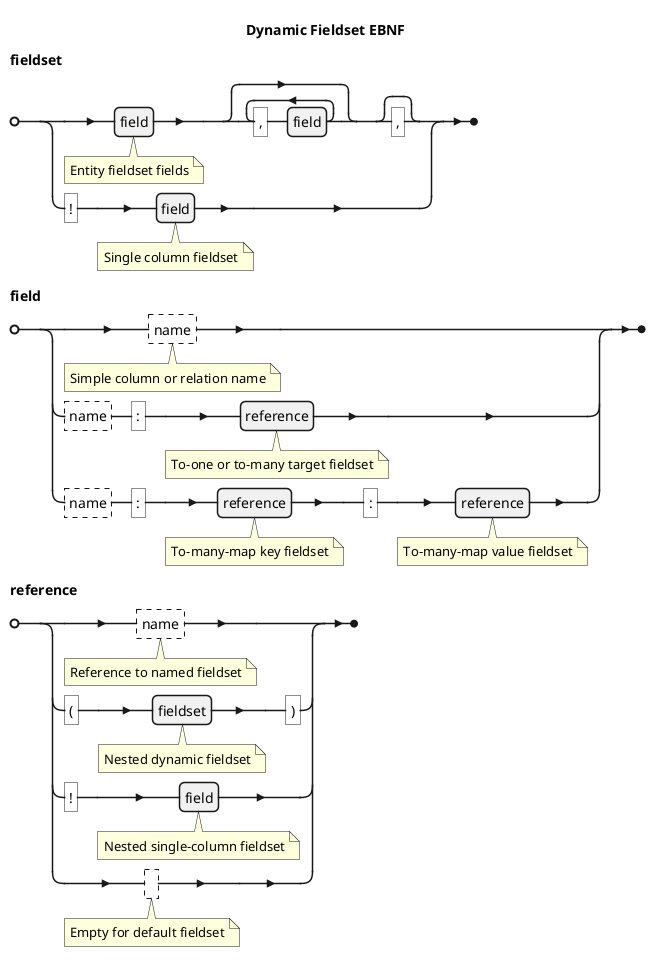
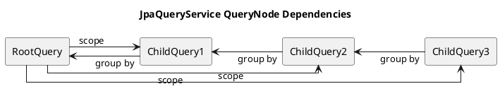
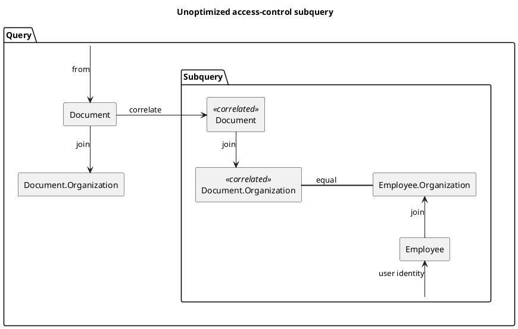
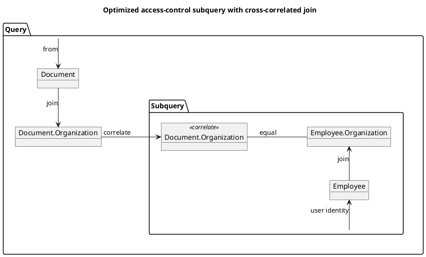

# 8. Advanced Features - Kiwi Server

This chapter is about some of the advanced features provided by Kiwi-Server that are required to build applications that
go beyond basic and standard use-cases.

## Custom ColumnTypes

New ColumnTypes can also be derived from existing ColumnTypes:

- `infix fun <T, M> ColumnType<T, M>.validate(validator: Validation<T>): ColumnType<T, M>` is an extension function that
  applies a `Validation` when attribute values are parsed using the returned ColumnType,
  see [Chapter 2: "Entity Validation"](./02-domain-schema.md#entity-validation).  
  This function is used internally to apply validations when using auto column validation.
- `infix fun <T, M> ColumnType<T, M>.map(mapper: (M) -> M): ColumnType<T, M>` is an extension function that applies the
  given mapping function when formatting entity attribute values using the returned ColumnType
- `infix fun <T, M, R> ColumnType<T, M>.pipe(other: ColumnType<M, R>): ColumnType<T, R>` is an extension function that
  pipelines two ColumnTypes together, returning a single ColumnType which applies the given component types
  consecutively
- `infix fun <T, M> ColumnType<T, M>.withFilters(filters: ColumnFilterSet): ColumnType<T, M>` is an extension function
  that returns a copy of the given ColumnType, associated with the different ColumnFilterSet, customizing which
  ColumnFilterOperators are supported by columns using the returned ColumnType,
  see ["ColumnFilterSet"](#custom-columnfilteroperators).

> TODO: Example defining custom column type, deriving column type from existing

## Custom ColumnFilterOperators

This section expands upon column filters, as seen
in [Chapter 4: "Column Filters"](./04-querying-access-control.md#column-filters).

The ColumnFilterSet interface represents a collection of ColumnFilterOperators, each implementing a specific filter
operation associated with an operator symbol.
For well-known filter operators, Kiwi pre-defined a set of common ColumnFilterSets:

- `emptyColumnFilters` does contains no operators, disallowing filtering on columns using the associated column type
- `basicColumnFilters` contains `eq` (equal), `ne` (not equal), `in` (in list), `not` (not in list), and `null` (value
  is null) filter operators, with `in` being the default operator
- `standardColumnFilters`, which is the default ColumnFilterSet for ColumnTypes, extends the `basicColumnFilters` and
  adds the `gt` (greater than), `lt` (less than), `ge` (greater or equal), and `le` (less or equal) operators
- `patternMatchColumnFilters` extends the `standardColumnFilters`, and adds the `contains` (string contains) operator

> TODO: Example defining custom filter operator, custom filter set, and attaching filter set to column type

## Dynamic Fieldset Syntax

This section expands upon dynamic ad-hoc fieldsets passed using the `fields` parameter, as seen
in [Chapter 6: "Dynamic Fieldsets"](./06-web-mvc-endpoints.md#dynamic-fieldsets).

At the top level, a dynamic fieldset expression is a comma-separated list of fields.
Whitespace between symbols or field names is ignored.

Each field is specified by its name, and an optional fieldset-reference if the given field is a to-one, to-many, or
to-many-map relation field. As a special syntax, a field prefixed by a bang ("!") character specifies a single-column
fieldset, only returning the value of a single column without a surrounding object.

- Fieldset with fields "a", "b", and "c": `"a,b,c"`
- Single-column fieldset of column "a": `"!a"`

Relation fields like to-one, to-many, or to-many-field references use the default fieldset of the referenced entity by
default. This can be customized by appending a colon (":") character, followed by a fieldset reference. In the case of a
to-many-map relation, both the key- and value-fieldset can be specified using two fieldset references separated using
another colon (":") character.

A fieldset reference can be the name of a named fieldset, a single column fieldset as a bang ("!") character followed by
the field, or a nested dynamic fieldset within parentheses.

-
- Fieldset with columns "a" and "b", and to-one reference "parent" with default fieldset: `"a,b,parent"`
- Fieldset with column "a" and to-one reference "parent" with short fieldset: `"a,parent:short"`
- Fieldset with column "a", and to-one reference "parent" with single-column fieldset of field "x": `"a,parent:!x"`
- Fieldset with column "a", and to-one reference "parent" with nested dynamic fieldset: `"a,parent:(x,y)"`

For deeply nested relations, dynamic fieldset references can be similarly nested.

- Very deeply nested fieldsets: `"a,b,foo:(id,bar:(id,name,baz:short,qux:!id),x,y)"`, resolves to:
    - Field "a"
    - Field "b"
    - Field "foo", with dynamic fieldset reference:
        - Field "id"
        - Field "bar", with dynamic fieldset reference:
            - Field "id"
            - Field "name"
            - Field "baz" with named fieldset reference to "short" fieldset
            - Field "qux" with single-column fieldset reference to field "id"
        - Field "x"
        - Field "y"

A complete graph of the dynamic fieldset expression grammar is shown here:



## Deep Dive into JpaQuerySchemaService

The `QuerySchemaService` interface provides methods to load serialized representations of one, all of, or a page of
entities matching a given specification. The entity data structure, and data of related entities, is determined using a
fieldset parameter. The serialization if the entity data structure is determined by an optional fieldset-serializer
parameter. By default, the entity is serialized as a JSON data structure, represented by a Jackson `JsonNode`.

### JPA QuerySchemaService Algorithm

The `JpaQuerySchemaService` implementation uses a recursive tree-based algorithm to query entity data and relations
according the given fieldset using JPA Criteria queries.

- For the root entity, a `RootQueryNode` is created
    - The root query is selected from the root entity type
    - The selections of the root fieldset are added to the root query
        - The primary key of the root entity is added to the selections
        - For each `column` of the root fieldset, a selection is added to the root query
        - For each `toOne` relation of the root fieldset, an SQL join is added and the selections of the relation are
          added recursively
            - The presence of toMany relations within the `toOne` is handled separately
    - The predicate of the root query is applied using the given `Specification`
    - The ordering of the root query is applied using the given `Sort`
- For each `toMany`/`toManyMap` relation, a `ChildQueryNode` is created
    - The child query is selected from the root entity type recursively joining down to the child entity type
    - The selections of the child fieldset are added to the child query
        - The primary key of the child entity and its immediate parent entity are added to the selection
        - Selection of `column`s and `toOne` relations are added in the same way as the root query
    - The predicate of the child query is applied such that the child results are within the *root scope*
        - The root scope, determined during execution, is the range of primary key values found in the *root query*
          result-set
    - Recursive `ChildQueryNode`s are created for `toMany`/`toManyMap` relations within the child fieldset
- Limit and offset are applied to the `RootQueryNode`
- The `RootQueryNode` is executed, retrieving the root query result-set
    - The *root scope* of the query is determined by collecting a set of all root primary key values in the result-set
    - Each `ChildQueryNode` is executed within the root scope, grouping their results by their parent primary key values
        - Recursive `ChildQueryNode`s are executed recursively as "grandchild queries"
    - The selected rows within the result-set are mapped and serialized into entity fieldset datastructures
        - `toOne` relations are grouped into nested objects
        - `toMany` relations are grouped into lists obtained from child query executions and looked up by the parent's
          primary-key value
- The resulting serialized datastructures represent entity data using the given fieldset
- If pagination is used, a second query with the same root predicate is executed to get the total number of items

The recursive scoping and grouping of root- and child-queries is illustrated in the following figure:
A root-query has a child, which in turn has a grandchild, and in turn a great-grandchild. Each child is scoped by the
root-query, and groups its results by its immediate parent.
This way, child-queries query all relevant data from the database, while avoiding the N+1 problem as well as allowing to
load multiple to-many relations with linear performance.



The JpaQuerySchemaService implementation also incorporates evaluation and field-filtering based on FieldAccessControl
directives, as discussed in [Chapter 4: "Field Access Control"](./04-querying-access-control.md#field-access-control).

## Cross-Correlated Joins in Access-Control

The cross-correlated join is a special extension of access-control predicate subqueries.
They can be used to optimize exists-subqueries used to declare access-control rules by reusing joined tables from the
outer query, instead of repeating the same join within the subquery.

As a practical example, a simple model is defined with the following entities:

- Employee: Linked to UserDescriptor identity, belongs to one or more organizations, owns many documents
- Organization: Contains many employees, contains many documents
- Document: Owned by one or more employees, belongs to one organization

A read-only access-control rule could be defined like this:

> An employee, when matched with the current user identity, may access a document
> when the document belongs to the same organization as the employee.

This rule could be implemented like this:

```kotlin
// AccessControlBuilder matching UserDescriptor.identity to Employee.identity
val employeeAccessControl = AccessControlBuilder.byUserRelation<Employee> { employee, user ->
    equal(employee[Employee_.identity], user.identity.toString())
}

// AccessControl checking that document organization equals employee organization
val readDocumentPermission = employeeAccessControl<Document> { document, employee ->
    // document -> organization == organization >- employee
    val documentOrganization = document.join(Document_.organization)
    val employeeOrganization = employee.join(Employee_.organizations)
    equal(documentOrganization, employeeOrganization)
}
```

The query generated by the above `readDocumentPermission` rule would generate an SQL predicate that correlates the root
`document` entity, and may perform the `document.organization` join twice: Once in the top-level query, and a second
time in the predicate subquery. This suboptimal query graph is visualized here:



This redundant join can be optimized by correlating the `document.organization` table of the top-level query within the
predicate subquery, and only performing the join within the subquery if the top-level query does not already perform it.
The `crossCorrelatedJoin` function is provided to perform this operation:

```kotlin
val readDocumentPermissionOptimized = employeeAccessControl<Document> { document, employee ->
    // Optimized version of "document.join(Document_.organization)"
    val documentOrganization = document.crossCorrelatedJoin(Document_.organization)
    val employeeOrganization = employee.join(Employee_.organizations)
    equal(documentOrganization, employeeOrganization)
}
```

> NOTE: This optimization is only useful when joining from a correlated root of the top-level query.
> Tables exclusive to the subquery, such as Employee in the example above, don't profit from this optimization.

The query generated by this `readDocumentPermissionOptimized` rule would generate an SQL query that is able to use the
top-level joined table for correlation within the subquery. This optimized query graph is visualized here:


