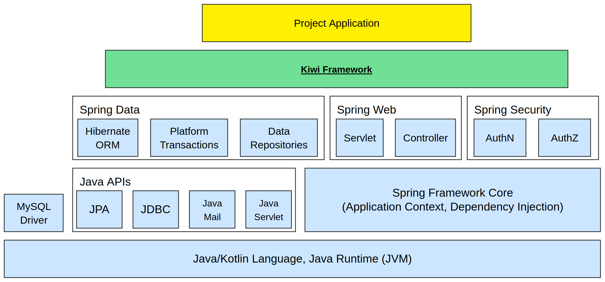
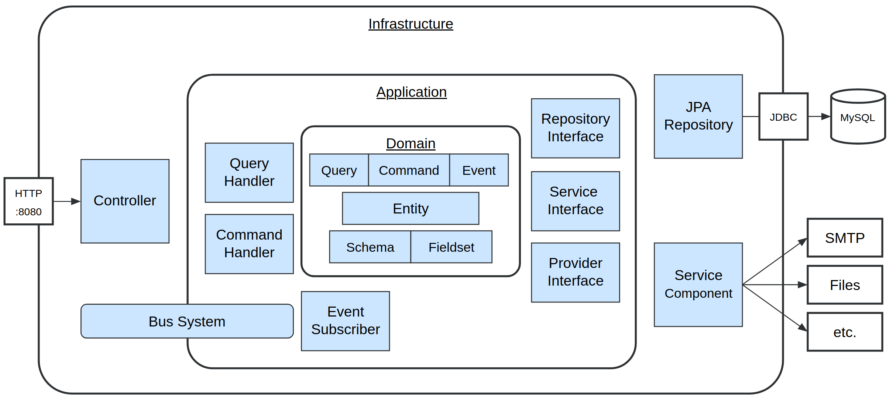
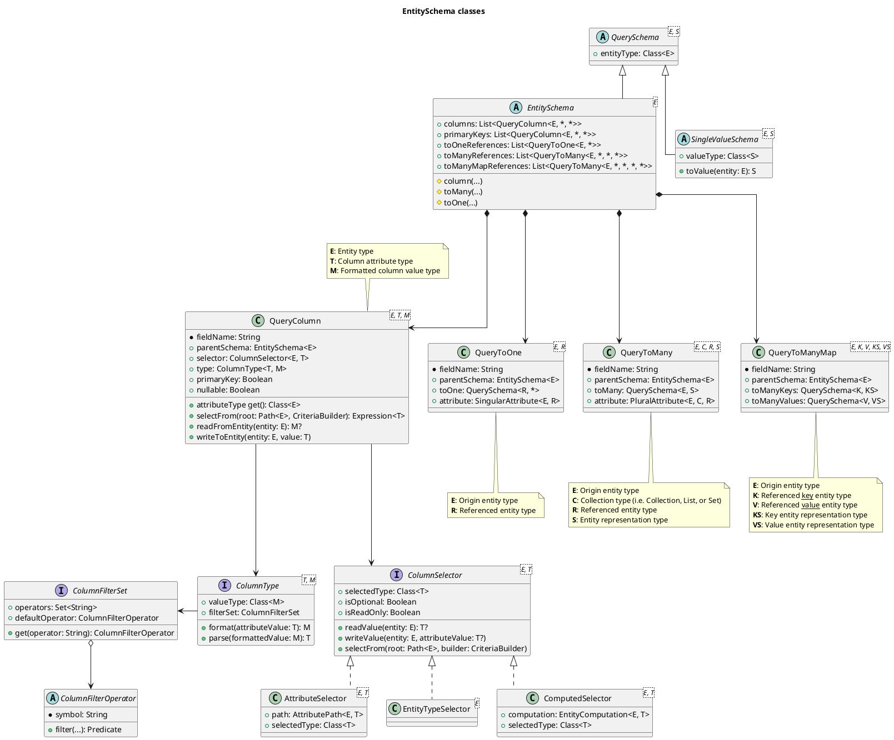

# Appendix - Kiwi Server

This chapter contains extended material on the Kiwi Server framework, which may be referenced and supplement other
chapters.

## Glossary

### Bean

- A bean is an instance of a class managed by the Spring application context (see
  ["Introduction to the Spring IoC Container and Beans"](https://docs.spring.io/spring-framework/reference/core/beans/introduction.html))
- Beans can have dependencies to, or be used as dependencies by, other beans (see
  ["Dependency Injection"](https://docs.spring.io/spring-framework/reference/core/beans/dependencies/factory-collaborators.html))
- Bean instances can be programmatically created, configured and provided on application startup
  using [@Configuration](https://docs.spring.io/spring-framework/reference/core/beans/java/configuration-annotation.html)
  classes with @Bean methods

### Entity

- An entity represents a persistent object within the business domain of the application
- An entity type is typically represented as a class annotated with @Entity inheriting from BaseEntity,
  with an associated ID class inheriting from EntityId
- Each managed instance of an entity corresponds to one row in its associated database table
- Entity class attributes are mapped to database table columns using @Column or @JoinColumn annotations
- Entity classes can refer to each other with relations using @OneToOne, @OneToMany, @ManyToOne or @ManyToMany
- Entity objects are managed by an EntityManager of the application Persistence Unit

### Command

- A command is an object of a command class, which is submitted to a [CommandBus](#commandbus) in order to modify the
  application state and emit DomainEvents when handled by a [CommandHandler](#commandhandler)

### CommandBus

- The command-bus is a service interface providing functionality to interact with the application core using commands
- Implementations of the command-bus decorate the basic bus, implementing shared concerns such as transactions, command
  authorization, relaying events to the event-bus, and automatically registering command-handler beans to the bus

### CommandHandler

### DomainEvent

### EventBus

### EventSubscriber

### Query

- Query, within the context of applications, is a highly ambiguous word used by multiple aspects of the framework
- In Kiwi specifically, a query is an object of a query class, which is resolved by a [QueryBus](#querybus) in order to
  read data from the application state when handled by a [QueryHandler](#queryhandler)

### QueryBus

- The query-bus is a service interface providing functionality to access data from the application core using queries
- Implementations of the command-bus decorate the basic bus, implementing shared concerns such as read-only
  transactions, query authorization, and automatically registering query-handler beans to the bus

### QueryHandler

### Service Interface

- A service interface, sometimes just referred to as a service, abstracts functionality required by the application
  that depends on external or infrastructure-dependent implementation details
- Implementations of service interfaces are provided as beans, such that applications can depend on it without
  having to know the details hidden behind the service interface
  (see ["Dependency inversion principle"](https://en.wikipedia.org/wiki/Dependency_inversion_principle))

### Repository

- A repository is an interface for interacting with persistent entities in a database
- Repositories can be used to query, save (store/update), and delete entities

## Snowflake IDs

The Kiwi-Server Framework uses a type of [Snowflake IDs](https://en.wikipedia.org/wiki/Snowflake_ID) to universally
uniquely identify entities within the system using a single key.

Snowflake IDs are universally unique 60-bit integers upon being generated.
These 60 bits, made to fit neatly into a 12-character base32 string, are composed of the following components:

- 42 bit timestamp in milliseconds, offset from 2024-01-01 00:00:00 UTC.
- 10 bit machine ID, based on hashing the local hostname of the current machine.
- 8 bit sequence ID, used in case multiple IDs are generated at the same millisecond on the same machine.

The binary representation is `0000ttttttttttttttttttttttttttttttttttttttttttmmmmmmmmmmssssssss`
(`t` = Timestamp bit, `m` = Machine ID bit, `s` = Sequence ID bit).

When serialized as a string, Snowflake IDs are encoded as a base32 string.
Base32 encoded IDs can contain the following characters:

- Numeric characters (0-9).
- Alphabetic characters (A-Z), case-insensitive, excluding the ambiguous letters `I`, `O` and `Z`.
- When decoding, erroneous characters are treated as their respective similar number: I => 1, O => 0, and Z => 2.

The source code for generating these Snowflake IDs can be found
in [Snowflake.kt](../api/src/main/kotlin/de/kiwi/api/domain/Snowflake.kt)

### Advantages of Snowflake IDs

- Snowflake IDs are sortable by their time of creation, the timestamp of which can be extracted from the ID itself.
- Since the timestamp bits are assigned to the most significant bits of a Snowflake ID, the values of the ID are
  monotonically rising over time, which is advantageous for using them in database indexes.
- Snowflake IDs are smaller (60 bits, represented using 64 bit `Long`/`BIGINT` type) than UUIDs (128 bits) and can be
  saved in a single numeric database column.
- Variations of Snowflake IDs are widely used by various services, such as Discord, Instagram, Twitter and Mastodon.

## Architecture diagrams

This section contains diagrams relevant to framework- and application-architecture

### Kiwi-Server Framework Stack

This diagram shows an overview of the technology stack powering the Kiwi-Server Framework

### Application Module Architecture

This diagram shows an overview of the architecture within a project application module

## Class Diagrams

This section contains class diagrams for various components of the Kiwi-Server framework.

<!--
These diagrams are written in [PlantUML](https://plantuml.com/en-dark/class-diagram), and can be viewed in Markdown
renderers that support inline PlantUML diagrams.

If you do not see the below diagrams, go to the
[PlantUML online editor](https://editor.plantuml.com/uml/SoWkIImgAStDuL9NyCmhJYqgKGZ8ISmh2VNrKKZ9J4mlIinLo4WjIkLoICrB0Ie30000)
and copy-paste the diagram code.
-->

### EntitySchema class diagram

## Example application project

Here is a list of all relevant files and directories present in the example application used throughout this guide,
along with a short description of what each file or directory contains:

| File                                                        | Description                                                                |
|-------------------------------------------------------------|----------------------------------------------------------------------------|
| settings.gradle.kts                                         | Gradle project settings                                                    |
| build.gradle.kts                                            | Gradle project build file                                                  |
| gradlew                                                     | Gradle wrapper script, can download and execute gradle for project         |
| gradlew.bat                                                 | Windows-specific version of gradlew                                        |
| compose.yaml                                                | Docker compose file used for SpringBoot docker-compose services            |
| .gitignore                                                  | Git configuration file specifying which files to ignore in version control |
| gradle/                                                     | Gradle download directory used by gradlew                                  |
| .gradle/                                                    | Temporary gradle project build/cache files                                 |
| build/                                                      | Build files and artifacts generated by gradle tasks                        |
| build/todo-app.model.ts                                     | Fieldsets typescript source-file generated by FieldsetSourceGeneratorTool  |
| build/libs/                                                 | Output directory for .jar artifacts                                        |
| src/main/kotlin/                                            | Kotlin main-module sources directory - contains main Kotlin code           |
| src/main/kotlin/com/example/                                | Base package directory for application code                                |
| src/main/kotlin/com/example/ExampleApplication.kt           | Main class of application, entrypoint for @SpringBootApplication           |
| src/main/kotlin/com/example/domain/                         | Todo-App domain package directory                                          |
| src/main/kotlin/com/example/domain/TodoEntities.kt          | Todo-App domain entity classes                                             |
| src/main/kotlin/com/example/domain/TodoSchema.kt            | Todo-App domain entity schema- and available-fieldsets objects             |
| src/main/kotlin/com/example/domain/TodoCommands.kt          | Todo-App domain command classes                                            |
| src/main/kotlin/com/example/domain/TodoQueries.kt           | Todo-App domain query classes                                              |
| src/main/kotlin/com/example/domain/TodoEvents.kt            | Todo-App domain event classes                                              |
| src/main/kotlin/com/example/application/                    | Todo-App application package directory                                     |
| src/main/kotlin/com/example/application/TodoHandlers.kt     | Todo-App application command-, query- and event-handlers                   |
| src/main/kotlin/com/example/application/TodoRepositories.kt | Todo-App application repository interfaces                                 |
| src/main/kotlin/com/example/web/                            | Todo-App web package directory                                             |
| src/main/kotlin/com/example/web/IndexController.kt          | Index controller mapped to "/"                                             |
| src/main/kotlin/com/example/web/TodoController.kt           | Todo-App web controllers, mapped to "/TodoItem" and "/TodoList"            |
| src/main/resources/                                         | Main-module resources directory - contains main resource files             |
| src/main/resources/application.yml                          | Main application configuration file                                        |
| src/main/resources/db/changelog/                            | Liquibase changelog-files directory                                        |
| src/main/resources/db/changelog/db.changelog-master.yaml    | Liquibase master-changelog file, entrypoint for Liquibase migrations       |
| src/main/resources/db/changelog/db.example-01.yaml          | Liquibase migration file, version 01 of example todo-app database schema   |
